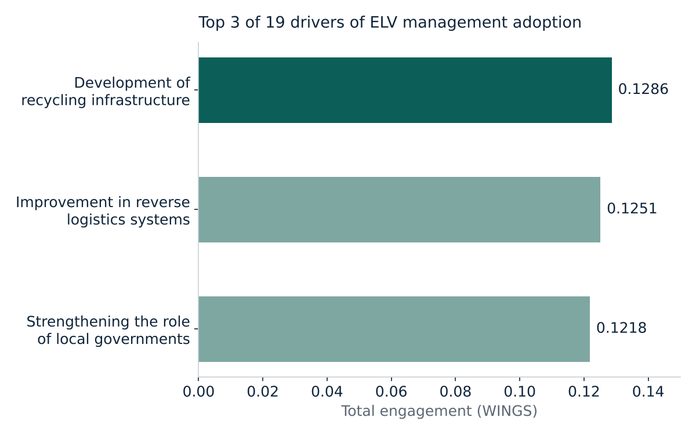
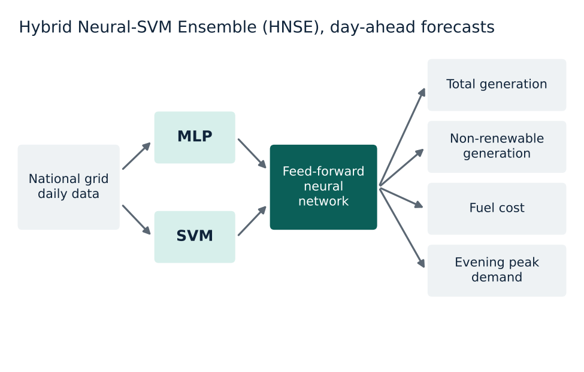
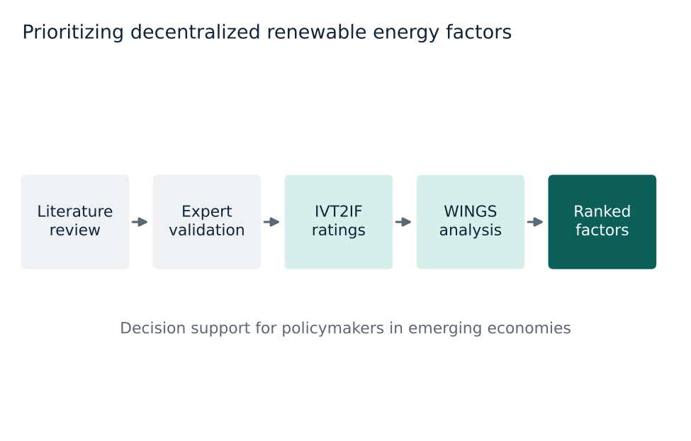
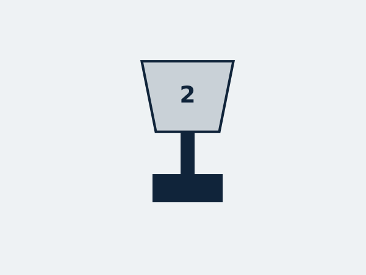
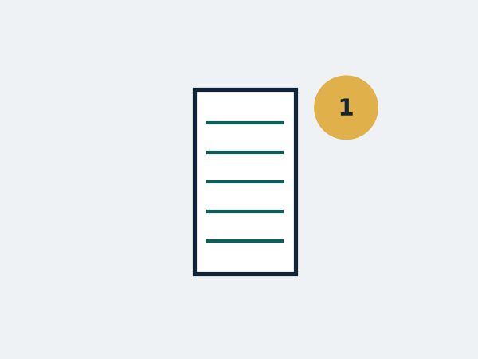

I am a Lecturer in the Department of Industrial and Production Engineering at Ahsanullah University of Science and Technology (AUST), Dhaka, where I teach undergraduate courses in industrial and production engineering and contribute to curriculum development under Outcome-Based Education. I graduated from AUST in 2025 with a B.Sc. in Industrial and Production Engineering, ranked first in my batch (CGPA 3.97/4.00), and received the Khan Bahadur Ahsanullah Gold Medal.

My research applies **machine learning to human-centered industrial systems**. As a research assistant, I worked on a project on occupational safety and ergonomics in Bangladesh's ready-made garments (RMG) industry, where we collected ECG, EMG, EDA and EEG signals from workers during garment-packaging tasks and built models to classify physiological workload. I have also worked on multivariate time-series forecasting for energy management and supply chains, and on fuzzy decision analytics for sustainability problems in emerging economies.

**Research interests**

- Applied machine learning, predictive and prescriptive analytics
- Human factors, occupational ergonomics and human-centered AI
- Reinforcement learning
- Operations research and decision science
- Socio-technical systems
- Energy and sustainable industrial systems

#### Selected research

Top 3 of 19 drivers by total engagement. Values from the paper.

<a href="https://doi.org/10.1016/j.wmb.2026.100318" target="_blank" rel="noopener">Evaluating the drivers behind the adoption of end-of-life vehicle management systems in Bangladesh</a>

Waste Management Bulletin, 2026

We combined interval valued type 2 intuitionistic fuzzy sets with the WINGS method to evaluate 19 expert-validated drivers. Building recycling infrastructure, improving reverse logistics and strengthening local governments had the most influence. A stronger local government role was also the main causal driver, followed by applying the polluter pays principle to vehicle disposal.

Model overview.

<a href="https://doi.org/10.1016/j.nexus.2026.100641" target="_blank" rel="noopener">Multivariate time series energy forecasting using a hybrid neural-SVM ensemble model</a>

Energy Nexus, 2026

Most earlier studies forecast a single energy variable. We built a hybrid model that joins an MLP and an SVM through a feed-forward neural network to forecast four linked quantities for Bangladesh's national grid one day ahead: total generation, non-renewable generation, fuel cost and evening peak demand.

Method overview.

<a href="https://doi.org/10.1016/j.dajour.2025.100662" target="_blank" rel="noopener">An intuitionistic fuzzy analytics approach for examining factors in decentralized renewable energy adoption in emerging economies</a>

Decision Analytics Journal, 2026

Countries like Bangladesh still rely heavily on centralized, non-renewable power. We identified the factors that shape adoption of decentralized renewable energy systems, then ranked them and mapped their cause and effect links with an IVT2IF WINGS framework, giving policymakers a basis for deciding which interventions to prioritize.

<a href="/publications/">All publications</a>

#### Awards

<a href="https://www.aust.edu/achievements_of_students/3237" target="_blank" rel="noopener">Khan Bahadur Ahsanullah Gold Medal</a>

AUST, 2025. Highest CGPA in the graduating batch.

Dean's List of Honor

AUST, 2025. CGPA above 3.75.

Full Free Tuition Award

AUST. Top 5% of the batch, every semester.

<a href="https://www.aust.edu/mpe/departmental_activities/2564" target="_blank" rel="noopener">100% Scholarship, ISCEA Prize</a>

ISCEA, 2024. Top 6 teams, Supply Chain Case Competition.

First Runner-up, Supply Chain Research Challenge 4.0

BIHRM, 2024. Best supply chain research idea and demonstration.

<a href="https://www.aust.edu/mpe/departmental_activities/1694" target="_blank" rel="noopener">First Place, IPE Product Showcasing</a>

AUST, 2023. Prototype design, CAD modeling and material selection.

<a href="https://www.aust.edu/achievements/1642" target="_blank" rel="noopener">Best Paper Award, 17th Annual Paper Meet</a>

Institution of Engineers, Bangladesh, 2023. Paper writing and research presentation.

